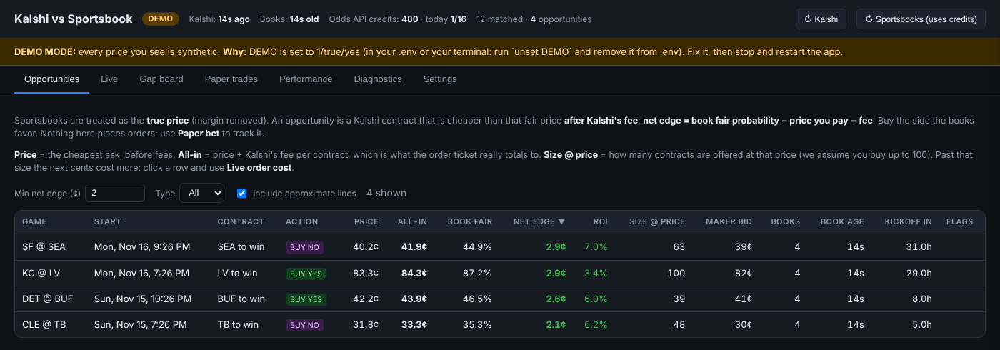

# Kalshi vs Sportsbook · Edge Finder (v1.2: multi-sport, live tab, order cost)




Treats sportsbooks as the "true price" (bookmaker margin removed), compares it to Kalshi's contracts, and flags the
ones cheaper than the books' fair price **after Kalshi's fee**. Read-only: it never places an order. Use **Paper bet**
to track what you would have done.

```
The Odds API ─► de-vig + weighted consensus ──┐
   (one call per sport)                       ├─► match games ─► edge = fair − price − fee ─► UI
Kalshi public API (no key) ───────────────────┘        (per sport)         │
                                    SQLite: snapshots, paper trades, credit ledger ◄──┘
```

## Run it
```bash
python3 -m venv venv && source venv/bin/activate      # first time only
pip install -r requirements.txt
cp .env.example .env                                   # then put your ODDS_API_KEY in .env
python run.py                                          # http://127.0.0.1:8000
python -m pytest tests -q                              # 122 tests
```

## Choosing sports
In `.env`: `SPORTS=nfl,nhl,mlb` (options: `nfl nba wnba nhl mlb`), then restart. A chip bar appears under the tabs: filter
everything by sport, or view all together. Off-season sports simply show nothing and cost almost no credits.

| Sport | Moneyline series | Spread/total handling |
|---|---|---|
| NFL / NBA / WNBA | KXNFLGAME / KXNBAGAME / KXWNBAGAME | exact line match, or bridged up to 1 pt (NFL) / 1.5 pts (NBA, WNBA); NFL never across 3 or 7 |
| NHL / MLB | KXNHLGAME / KXMLBGAME | **exact line match only** (low-scoring games: a bell curve is a bad bridge) |

`COMPARE=ML,SP,TOT` adds spreads/totals (1 extra credit per call each). Kalshi's series names `KXNFLSPREAD/TOTAL`,
`KXMLBSPREAD/TOTAL`, `KXWNBASPREAD/TOTAL` are confirmed; **`KXNBASPREAD/TOTAL` and `KXNHLSPREAD/TOTAL` are assumed from the
naming pattern.** Anything the app cannot read is listed in Diagnostics. Moneylines are by far the most liquid, so start there.

## Reading the price columns (and why 48¢ can cost 49¢)
* **Price**: the cheapest ask, before fees. **All-in** = price + Kalshi's fee per contract: this is what the order ticket totals to.
  Example: a 48¢ ask at 100 contracts is 48.0¢ + 1.75¢ fee ≈ **49.8¢ all-in**. The net-edge number always included this fee; the old
  table just did not show it next to the price.
* **Size @ price**: contracts offered at that price. We assume you buy up to 100 (or the available size, if smaller) when estimating fees.
  Past that size you walk up the book and the average gets worse.
* **Live order cost** (in every row's details): type a size and the app reads Kalshi's real order book, walks it level by level, and
  shows average price, slippage vs the board, fee, total cost, and the edge **after all costs**. Free (public data, no credits).
* The board refreshes every ~20 s; the order book is read the moment you click, so it is the freshest number on screen.

## Live tab (games in progress)
Off by default every time you launch. Press **Start live mode** on the Live tab.
* Kalshi is refreshed every **3 s** (free). Sportsbooks every **30 s** (minimum 10 s), which **costs 1 credit per call per sport with a
  game on**: ~120 credits/hour per sport at defaults. A **session budget** (default 100 credits) pauses sportsbook polling when used up.
  The 500-credit free tier is therefore about 4 hours of one sport per month; the $30 plan (20,000 credits) is ~160 sport-hours.
* In-game odds only count if the book quote is **fresh** (default < 90 s old); books that stopped updating (suspended) are ignored.
* Stricter bar than pregame: net edge ≥ 3¢ (not 2¢), spread ≤ 6¢. Ages, "stale" flags and tradability are recomputed **every time you
  look**, so if either feed stalls the rows turn red instead of freezing at their last fresh look.
* Columns **Moved 30s / 2m** show how far Kalshi's price has just jumped. A big recent move *toward* the book usually means the gap is
  already closing. Live trades are tagged **LIVE** and judged separately (Performance → "Live only").
* Honest limit: the sportsbook side is polled, not streamed. In-game, a 30 s-old book price is old. This tab makes gaps visible faster and
  keeps score; it is not a latency edge. Judge it by the paper-trade results, not by a good weekend.

## Credits: how they are rationed (free tier = 500/month ≈ 16/day, shared by ALL sports)
* **Kalshi is free** and polled every 20 s. **Odds API calls are the scarce resource.**
* A sport is polled only when it matters: *hot* (next start within 3 h) every 30 min, *warm* (within 12 h) every 90 min,
  **never** beyond 12 h (far-out lines are noise), and an idle/off-season sport is re-checked every 6 h.
* The most urgent sport (soonest start) goes first. A **rolling 24 h cap (default 16)** is a hard stop; a **reserve of 25** is
  never touched, not even by a manual refresh. A manual refresh may exceed the daily cap on purpose; the header shows `today x/16`.
* Correction to v1: its README implied ~84 calls/week for the NFL; with a 36 h window it would actually have used
  most of the month's credits in ~2 weeks. v1.1 fixes this with the cap and the kickoff-aware schedule above.

## Upgrading from v1
Copy the new files over your folder; **keep your `.env` and your `.db`**. Your database upgrades itself on first start
(columns are only added; old snapshots and paper trades become `nfl`). Settings you save in the UI now persist across restarts.
Your old `.env` keeps working (NFL only); add `SPORTS=...` to enable more.

## The math (unchanged)
* **De-vig** per book (power method default), **consensus** = weighted mean (Pinnacle ×3).
* **Net edge (buy YES)** = `fair − yes_ask − fee`; **(buy NO)** = `(1 − fair) − (1 − yes_bid) − fee`.
* **Taker fee** = `ceil_to_cent(0.07 × contracts × P × (1 − P))`.
* **Resting bid** (new meaning): one cent below the ask so it can't cross, capped so it still leaves your minimum edge. Moneyline
  makers pay no fee; spreads/totals subtract a small maker fee (`maker_fee_coef`, default 0.0175: verify on Kalshi's fee page).
  It may never fill: it trades certainty for price.

## Honest limits
1. **Free-tier book data is up to 30-90 minutes old.** A "gap" is often Kalshi reacting to news the books already priced. The
   **Performance → convergence** panel tells you whether Kalshi actually drifts toward the books after a flag. Trust it before P&L.
2. Thin markets: the biggest gaps live in illiquid contracts that may not fill at size.
3. No free history of Kalshi prices exists, so there is no backtest; the app records its own snapshots from first start.
4. Team abbreviations for NBA/NHL/MLB/WNBA were built from public conventions and are **not yet verified against live Kalshi
   tickers**. If a market shows under Diagnostics → unmatched, add its code to `team_tables.py` as an alias.
5. Kalshi sports contracts have been contested in some states; check availability for you. Not financial or legal advice.
